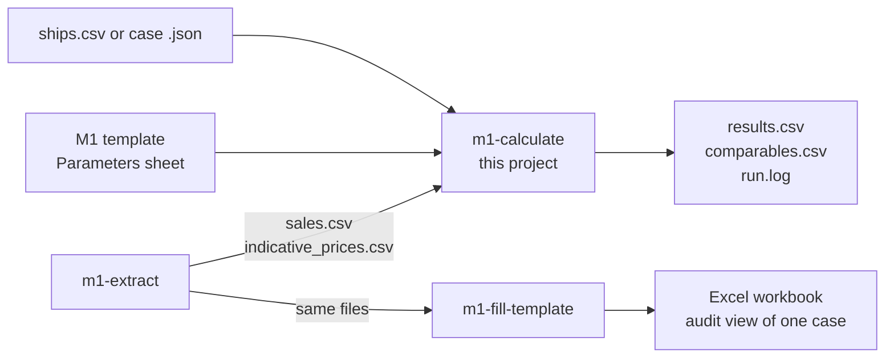

# Architecture

## Where this project sits

Python (this project) and Excel (through m1-fill-template) are two independent calculations of the same method from the same files and the same settings. The tests reconcile them.

## The steps and their Excel equivalents

| Function (`engine.py`) | Does | Excel equivalent |
|---|---|---|
| `benchmark_table` | OK benchmark dates and values of the active series | Benchmarks table 1 |
| `nearest_ok_date` | Nearest OK date, earlier on a tie | Sales Register AB; Benchmarks B72 |
| `age_at_sale` | Report year − year built | Sales Register S |
| `failed_rules` | Rules R1–R6 under the segment's settings | Sales Register AG |
| `automatic_screen` | No / Review / Yes | Sales Register W |
| `decision_used` | Reviewed decision overrides the screen when the case says so | Sales Register AH, AI |
| `benchmark_age` | Nearest of the three benchmark ages | Sales Register AD |
| `adjusted_price` | Price × index factor | Sales Register AC |
| `fit_curve` | OLS on LN(price): a, b, R², fitted prices, residuals | Age Curve O5–O8, D, F, G, T–Y |
| `value_ship` | Value, range, near-age check, known-price test, validity checks, status | Age Curve O11–O20; Outputs C29–C38 |

## Modules

| Module | Responsibility |
|---|---|
| `inputs.py` | Reads the data files (data contract), the Parameters sheet (typed settings only, never calculated cells) and the ships; stops with a clear message on anything unreadable |
| `engine.py` | The calculation; no file access |
| `outputs.py` | Writes the results into a new dated folder; never overwrites |
| `__main__.py` | Command line and exit codes |

## Design choices

| Choice | Reason | Record |
|---|---|---|
| Data and results stay outside Git | Licensing and confidentiality | ADR 0001 |
| Settings are read from the template's Parameters sheet | One source of settings, so Python and Excel cannot drift apart | ADR 0002 |
| Function and column names follow the Excel steps | Every number can be traced to a cell | ADR 0003 |
| Reconciliation with Excel is a test | Two independent calculations agreeing is the strongest check | ADR 0004 |
| Only the Python standard library for the maths | Few add-ons, easy to audit; OLS is a few lines | ADR 0005 |

## Limits

- The learning check (Sales Register X and Y) and the survey and data-check flags (M, V) are not reproduced: they do not affect the value.
- The ship list is valued with one data snapshot; a ship's own sale is excluded only when its name matches exactly.
