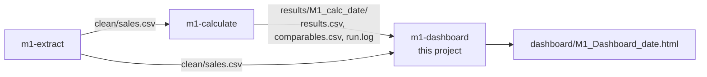

# Architecture

## Where this project sits

The dashboard only reads. It never changes the database or the results, so it can be run again at any time.

## Modules

| Module | Responsibility |
|---|---|
| `inputs.py` | Finds the newest Calculate run; reads results, comparables, the run record and (optionally) the database; clear message on anything missing |
| `charts.py` | Draws the charts as inline SVG: age curve, range strip, sales over time, sales by segment |
| `roadmap.py` | The model roadmap as data (models, links, what M1 gives each) and its diagram |
| `page.py` | Builds the four pages, the styles for light and dark themes, and the hover and page-switching script |
| `__main__.py` | Command line and exit codes |

## Chart choices

| Chart | Why this form |
|---|---|
| Hero value and tiles | The answer is a number; a chart would hide it |
| Age curve: dots, fitted line, one marked ship with a range | Shows the method itself: what the value is based on and how well the curve fits |
| Range strip in the ship table | Compares values and ranges across ships on one scale |
| Line of sales over time | Shows the database growing as the automation adds weeks |
| Ranked bars by segment | Compares counts; one colour, since segments have no order |

Colours follow a colour-blind-checked palette; status (VALID, warning, NOT VALID) always has an icon and a word, never colour alone. One axis per chart.

## Design choices

| Choice | Reason | Record |
|---|---|---|
| One self-contained HTML file | Opens anywhere, can be sent by email, works offline | ADR 0001 |
| Standard library only | Nothing to install; easy to audit | ADR 0002 |
| Reads Calculate's files, never recalculates | One source of numbers; the dashboard cannot disagree with Calculate | ADR 0003 |
