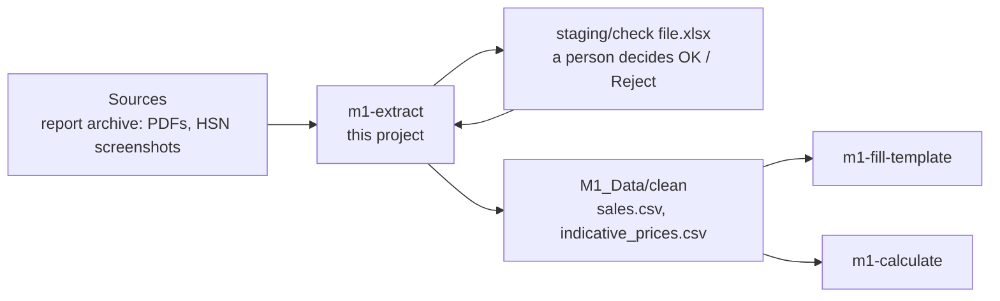

# Architecture

## Where this project sits



## One extract run

```text
find reports in Sources (PDF per report; HSN screenshots grouped by date, read _1 then _2)
 -> fingerprint each report; skip those on extracted_reports.csv
    (first run: reports already typed in M1 are listed as "typed in M1", not read)
 -> read each new report with its broker's reader
 -> for each sale: already in the data? (same name and year built, report dates within 150 days)
                   same sale read from another report this run? (keep the first, note the second source and any price difference)
 -> write the check file: suggestion, what to check, report and page, Decision filled in for clear rows (empty for Check rows)
 -> list the reports as "read, waiting for check"
```

## Adding checked rows

```text
read the check file -> every row has OK or Reject? (no: list the rows, add nothing)
 -> contract checks on the OK rows (required fields, segment list, sale type, limits)
 -> copy sales.csv and indicative_prices.csv to clean/backup/<date_time>_*
 -> append the OK rows (new sales get the next ids); existing lines are not touched
 -> move the check file to staging/done; list the reports as "checked and added"
```

## Reading methods

| Source | Method |
|---|---|
| Advanced (PDF) | Sales: every header line with Type, Name, YoB and Price starts a table (bulk / tanker / container / gas). Rows are anchored on the DWT (or TEU / cbm) column; every other word goes to the nearest row and to the column its position belongs to. Columns are found from the gaps in the text, not from the title positions (titles are centred). Indicative prices: one line per segment and age, read as text |
| Xclusiv (PDF) | Same table method on the "TANKER SALES" and "BULK CARRIER SALES" tables; the segment is worked out from DWT and flagged for checking |
| Intermodal (PDF) | Same table method on "Secondhand Sales"; segment from the size code (SUEZ, LR2, MR2, KMAX …), else from DWT |
| HSN screenshots | Apple's text recognition (macOS Vision) gives the lines; a pattern reads each sentence: segment, name, size, year, yard, seller / buyer, price, VV Value. The report date comes from the article title |

## Design choices

| Choice | Reason | Record |
|---|---|---|
| A person approves every row | A reading error in the data would move every valuation | ADR 0001 |
| Check file in Excel, not CSV | Excel would rewrite dates in a CSV; a list cell for the decision | ADR 0002 |
| Reports identified by fingerprint | Renaming does not cause a re-read; a corrected edition is read again | ADR 0003 |
| Append only, after a backup | The data so far stays exactly as it was; any addition can be undone from the backup | ADR 0004 |
| Apple text recognition for screenshots | Built into macOS, accurate on article text, nothing else to install | ADR 0005 |

## Limits

- Older Intermodal reports (weeks 7, 12 and 18 of 2026) use a different table layout and are mostly not read; the current layout (week 44) is.
- Xclusiv segment is worked out from DWT: tankers of 85,000–120,000 DWT may be LR2 or Aframax, and must be checked.
- Broker value tables are read for Advanced only (the ones used by the model). Xclusiv prints its tables sideways and Intermodal's are few.
- A sale the reader misses does not appear in the check file; the log shows how many sales each report produced, to compare with the report.
- Text recognition needs macOS.
