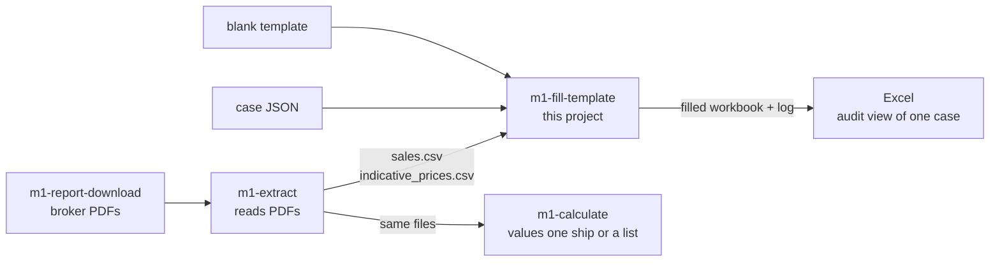
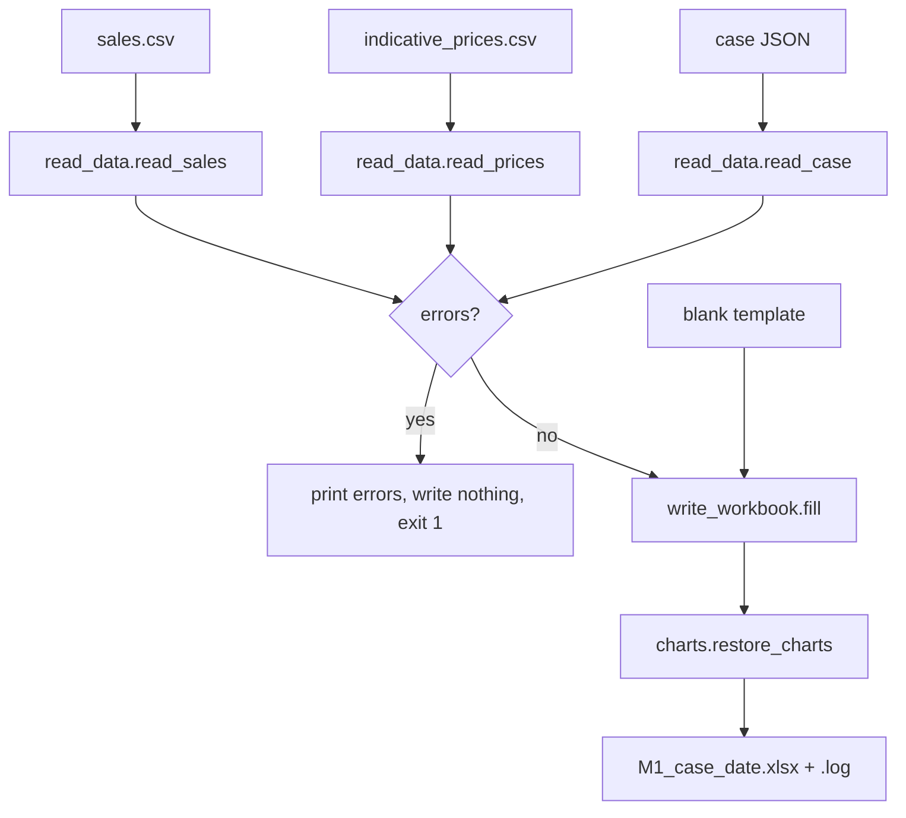

# Architecture

## Where this project sits

The projects share no code. They connect through two kinds of file whose format is written down: the **data contract** (`docs/data_dictionary.md`) and the **blank template**. A project can be rebuilt or replaced as long as it keeps to them.

## Inside this project

| Module | Responsibility |
|---|---|
| `contract.py` | The data contract as code: every field's column name, Excel column, type, required flag, allowed values, limits, meaning. Nothing else in the code hard-codes a column |
| `read_data.py` | Turns text into typed values (`parse_value`), checks each row (`read_table`), then whole-table checks: unique id, repeated sale, duplicate broker value, review reason |
| `write_workbook.py` | Confirms the template is blank, writes values into input columns only, writes the case, sets full recalculation, saves a new file |
| `charts.py` | Puts the template's original chart definitions back into the saved file |
| `__main__.py` | Command line, log file, exit codes |

## Design choices

| Choice | Reason | Record |
|---|---|---|
| Data stays outside Git | Broker licences and confidentiality; data changes weekly, code is reviewed | ADR 0001 |
| Write input columns only; never overwrite | Formulas are the model; a filled workbook must be reproducible from template + data | ADR 0002 |
| Blank template holds the 8 M1 sheets only | M1 formulas use no other sheet; other market data belongs to later models | ADR 0003 |
| Restore charts from the template | The Excel library rewrites charts with default formatting | ADR 0004 |
| CSV + JSON as the interface | Readable by any tool and by people; easy to check line by line | ADR 0005 |
| Errors stop the whole run | A partly filled workbook could be mistaken for a complete one | ADR 0002 |

## Limits

- openpyxl cannot calculate formulas. The filled workbook carries no calculated values until Excel opens it; the tests check the data with a separate reference calculation (`tests/reference_calc.py`).
- Capacity: 300 sales and 996 broker values (the template's ranges). The checks stop the run before anything is cut off.
- Only the M1 input columns are covered. A change to the template's columns needs the same change in `contract.py` and `docs/data_dictionary.md` (a test checks they agree).
